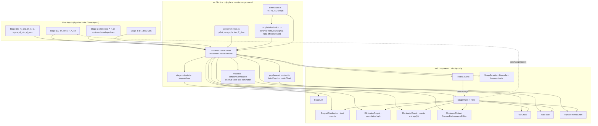

# Code Map, Physics Map and Consistency Check

Written: 2026-11-18. Source: `main` at `19f783f` (PR #20), working tree clean.

This file records three things:

1. what every file in `src/` and `tests/` does, and which files use it;
2. each calculation step in order, with its equation, location, units and
   source, and whether it is established theory or an assumption;
3. where the code, the physics and the documentation do not agree.

Nothing in the model, the interface or the other documents was changed while
this file was written.

---

## 1. File map

### `src/`

| File | What it does | Used by |
|---|---|---|
| `main.tsx` | Entry point. Mounts `App`, imports the bundled IBM Plex fonts and `styles.css`. | `index.html` |
| `App.tsx` | Holds the single `TowerInputs` state, calls `solveTower` and `compareEliminators`, maps each warning to the stage that causes it, links velocity and dry-air mass flow, and lays out the sheet (tower + stage list) against the open stage. | `main.tsx` |
| `styles.css` | All presentation. No numbers that affect results. | `main.tsx` |
| `lib/psychrometrics.ts` | Moist-air primitives: `pSat`, `humidityRatio`, `omegaSat`, `enthalpy`, `hSat`, `density`, `vapourPressure`, `dewPoint`. Pure functions. | `lib/model.ts`, `lib/psychrometric-chart.ts` |
| `lib/eliminators.ts` | Ruiz A–F geometries, `pressureCoefficient`, `collectionEfficiency`, `stokesNumber`, `airDynamicViscosity`, `evaluateRuizEliminator`, the supported-range limits, and the custom-performance option (`customEfficiency`, `customPressureDrop`). | `lib/model.ts`, `lib/stage-outputs.ts`, `components/StageResults.tsx`, `components/FanChart.tsx`, `components/FanTable.tsx`, `components/EliminatorPicker.tsx`, `components/CustomPerformanceEditor.tsx`, `components/chartTheme.ts` |
| `lib/droplet-distribution.ts` | The inlet log-normal by mass: `paramsFromMeanSigma`, `spread`, `cumulativeFunction`, `massBins`, `countHistogram`, `erf`, `massAboveCut`, `sigmaFromMinimum`, `minimumFromSigma`, and the grade-efficiency integral `efficiencySplit`. Also `massQuantile` and `sauterMeanDiameter`, which the app does not call. | `lib/model.ts`, `components/DropletDistribution.tsx`, `components/EliminatorCount.tsx` |
| `lib/model.ts` | The whole calculation assembly: `solveTower`, `distributionParams`, `dryAirMassFlowFromVelocity`, `velocityFromDryAirMassFlow`, `compareEliminators`, `DEFAULT_INPUTS`, and the `TowerInputs` / `TowerResults` / `SolveIssue` types. The only place that produces results. | `App.tsx` and every component |
| `lib/psychrometric-chart.ts` | Builds the psychrometric chart data: RH curves, constant-enthalpy lines, axis window, the two state points and the two-leg cooling path. Calculation only, no rendering. | `components/PsychrometricChart.tsx` |
| `lib/stages.ts` | Stage identity only: `StageId`, `STAGE_META` (name, air/liquid path, accent colour), `STAGE_GROUPS`, `STAGE_IDS`. No values. | `App.tsx`, `components/StageList.tsx`, `components/StagePanel.tsx`, `components/StageResults.tsx`, `components/TowerGraphic.tsx`, `lib/stage-outputs.ts` |
| `lib/stage-outputs.ts` | The key output of each stage for the list under the drawing: `stageValues` (label, TeX symbol, value, unit, digits, owning stage), `STAGE_KEY_OUTPUTS`, `stageSubtitle`. Display data only; every number comes from `solveTower`. | `components/StageList.tsx` |
| `lib/formula-tex.ts` | `FORMULA_TEX` and `FORMULA_NOTE`: the TeX for each plain-text formula string used in the calculated-values table. | `components/Formula.tsx`, `tests/formula-tex.test.mjs` |
| `lib/format.ts` | `fmt` (fixed decimals) and `sig` (significant figures). | most components |
| `components/StagePanel.tsx` | One open stage: its heading, its `Field` inputs, its graphs and its tables. Lazy-loads every chart. Also exports `STAGE_LABEL` (`1A`, `1B`, `2`, `3`, `4`). | `App.tsx`, `components/StageList.tsx` |
| `components/StageList.tsx` | Every stage's key outputs under the drawing, always visible, with the change indicator. | `App.tsx` |
| `components/StageResults.tsx` | "Calculated values": every input and every calculated value, by stage, each with its formula. The open stage first, all stages behind a disclosure. | `App.tsx` |
| `components/TowerGraphic.tsx` | The cooling-tower cutaway. Each labelled station shows one reading and selects that stage. | `App.tsx` |
| `components/DropletDistribution.tsx` | Stage 1B: the drift inputs (`ṁ_circ`, `D_in`, `E`, `σ`, `d_min`, `d_max`) and the inlet relative-count graph in 5 µm classes. | `components/StagePanel.tsx` |
| `components/EliminatorOutput.tsx` | Stage 2 graph 1: cumulative drift mass below `d` in kg/s for inlet, captured and escaping, read straight from `split`. | `components/StagePanel.tsx` |
| `components/EliminatorCount.tsx` | Stage 2 graph 2: relative droplet count per 5 µm class, inlet and escaping, with ε(d) on the right axis. | `components/StagePanel.tsx` |
| `components/EliminatorPicker.tsx` | Stage 2 table: A–F selection and drift comparison, plus the Custom switch that replaces the table with the editor. Holds its own hardcoded geometry strings. | `components/StagePanel.tsx` |
| `components/CustomPerformanceEditor.tsx` | The custom option: a Δp field and ten draggable ε bars at 5–300 µm. | `components/StagePanel.tsx` |
| `components/FanChart.tsx` | Stage 3 graph: ideal air power against face velocity for A–F and custom, with a marker at the selected velocity. | `components/StagePanel.tsx` |
| `components/FanTable.tsx` | Stage 3 table: `Kp`, Δp, air power and escaping fraction for every eliminator. Also the graph's legend and filter. | `components/StagePanel.tsx` |
| `components/PsychrometricChart.tsx` | Stage 4 graph: renders `buildPsychrometricChart` with the state table and tooltip. | `components/StagePanel.tsx` |
| `components/Field.tsx` | The slider-plus-number input used by every stage. Clamps and rounds on commit. | `StagePanel`, `DropletDistribution`, `CustomPerformanceEditor` |
| `components/Formula.tsx` | Renders one formula string through KaTeX, or leaves it as text. Lazy-loaded. | `components/StageResults.tsx` |
| `components/MathLabel.tsx` | Renders one short TeX symbol through KaTeX. Lazy-loaded. | `components/StageList.tsx` |
| `components/ChangeValue.tsx` | A number plus how much it changed since the last input move, held for 3 s. | `components/StageList.tsx` |
| `components/chartTheme.ts` | Shared graph colours, axis styles, axis labels, `diameterTicks`, `ELIMINATOR_COLORS`. | every chart, `FanTable`, `CustomPerformanceEditor` |
| `components/selectOnKey.ts` | Enter/Space handler for the table rows that act as radio buttons. | `FanTable`, `EliminatorPicker` |

### `tests/`

| File | What it covers |
|---|---|
| `flow-model.test.mjs` | 19 tests on `solveTower`: the velocity-driven Ruiz pressure loss for A–F, moist and dry-air mass conservation, the dry-air-flow/velocity round trip, one shared flow basis across eliminator, fan and recovery, monotonic response to velocity, the blowdown ratio, the escaping/captured mass balance, the drift mass flows, the grade-efficiency integral, invalid area/velocity/cycles, the custom Δp and ε path, the vane pitch-ratio range check, dry air with no dew point, and `compareEliminators` against full solves. |
| `droplet-distribution.test.mjs` | 14 tests on the distribution: `erf` against reference values, the 50 % and 84.1 % points, monotonicity and bounds, `F(d_max) = 1`, the 1 % point, the default fit against the Ruiz 2013 run-1 points within 7 %, the count histogram, invalid input handling, quantile and Sauter ordering, the E/σ/d_min/d_med round trip, and that `d_max` only cuts. |
| `formula-tex.test.mjs` | 2 tests: every `FORMULA_TEX` entry renders in KaTeX, and every formula string in `StageResults.tsx` has a TeX form or is on the plain-text list. |

Result on this commit: `npm test` 35 pass, 0 fail. `npm run build` succeeds.

Not covered by tests: `psychrometrics.ts` against reference tables, the
psychrometric chart builder, and every component (there is no DOM test setup).
`tsconfig.json` has `"include": ["src"]`, so `tests/` is not type-checked.

### Flow

Two details on the flow:

- The graphs and the comparison tables read `useDeferredValue` copies of the
  inputs and results (`App.tsx:36-38`), so they may lag the numbers by one
  frame while a slider is dragged. They are the same functions on the same
  inputs, not a second model.
- Area, velocity and dry-air mass flow are one basis, not three independent
  inputs. Editing `ṁ_da` is converted back to a velocity by
  `velocityFromDryAirMassFlow` (`App.tsx:51-59`).

---

## 2. Physics map

Symbols: `T` °C, `P` Pa, `ω` kg water / kg dry air, `h` kJ / kg dry air,
`ρ` kg/m³, `μ` kg/(m·s), `u` m/s, `d` µm, `A` m², `V̇` m³/s, `ṁ` kg/s,
`Δp` Pa, `P_air` kW, `Q` kW.

### Step 1 — Plume psychrometric state

| | |
|---|---|
| Equations | `p_sat(T) = 610.94 exp(17.625 T / (T + 243.04))`; `p_v = (RH/100) p_sat`; `ω = 0.62198 p_v / (P − p_v)`; `h = 1.006 T + ω(2501 + 1.86 T)`; `ρ = (1 + ω)P / (R_da T_K (1 + 1.6078 ω))` with `R_da = 287.055`; `T_dew` by inverting the same Magnus form on `p_v` |
| Where | `src/lib/psychrometrics.ts` — `pSat`, `humidityRatio`, `enthalpy`, `density`, `dewPoint`, `vapourPressure`; called in `src/lib/model.ts:165-172` |
| In | `plumeTemperature` °C, `plumeRh` %, `pressure` Pa |
| Out | `omega` kg/kg, `h` kJ/kg da, `rho` kg/m³, `dewPoint` °C, `pSat` Pa, `pv` Pa |
| Source | Magnus coefficients: Alduchov & Eskridge (1996). Enthalpy, humidity-ratio and density forms: ASHRAE Handbook — Fundamentals, ch. 1. |
| Status | Established theory. The Magnus form is a correlation, not IAPWS-IF97; see finding 8. Prescribing the plume state instead of predicting it from the water side is a model boundary, not physics. |

### Step 2 — Flow basis

| | |
|---|---|
| Equations | `V̇ = A u₄`; `ṁ_da = ρ₄ V̇ / (1 + ω₄)` |
| Where | `src/lib/model.ts:178-184`, `dryAirMassFlowFromVelocity`; inverse `velocityFromDryAirMassFlow` |
| In | `flowArea` m², `plumeVelocity` m/s, `rho` kg/m³, `omega` kg/kg |
| Out | `vDot` m³/s, `airMassFlow` kg/s dry air |
| Source | Mass continuity, with `ṁ_moist = ṁ_da(1 + ω)` by the definition of ω. |
| Status | Established theory. That the eliminator face area equals the full-face plume area, and that the velocity is uniform over it, are assumptions. |

### Step 3 — Inlet droplet-size distribution

| | |
|---|---|
| Equations | `μ_ln = ln E − σ²/2`; `d_med = e^(μ_ln)`; `d_min = e^(μ_ln − 2.3263σ)` (1 % of mass); `σ_g = e^σ = (d_med/d_min)^(1/2.3263)`; `LN(d) = ½[1 + erf((ln d − μ_ln)/(√2 σ))]`; `F(d) = LN(d)/LN(d_max)` below `d_max`, `F = 1` at and above it |
| Where | `src/lib/droplet-distribution.ts` — `paramsFromMeanSigma`, `spread`, `logNormalCumulative`, `cumulativeFunction`, `erf`; plus `sigmaFromMinimum` / `minimumFromSigma` for the linked `d_min` field and `massAboveCut` for the mass the cut removes |
| In | `dropletMean` E µm, `dropletSigma` σ (dimensionless), `dropletDMax` µm |
| Out | `F(d)` 0–1 by mass; `d_med`, `d_min` µm |
| Source | Log-normal shape: Ruiz et al. (2013), *Atmospheric Environment* 69:170–181, which found log-normal fitted measured cooling-tower drift better than Rosin–Rammler. `erf`: Abramowitz & Stegun 7.1.26, absolute error below 1.5e-7. Defaults E = 40.8 µm, σ = 0.555, `d_max` = 300 µm are a least-squares fit to their Fig. 9(a) run 1 (`d_med` = 35 µm, σ_g = 1.74). |
| Status | **Assumption.** Ruiz measured at the tower exit, downstream of an eliminator. Using that shape as the eliminator *inlet* is an assumption. Run 1 is asymmetric in ln d (σ about 0.36 below the median, 0.67 above), so one σ is a compromise; fit error reaches about 6.5 %. `d_max` renormalises the curve instead of correcting the mean — a documented choice, because a mean correction ran away as `d_max` approached E. |

### Step 4 — Inlet drift mass flow

| | |
|---|---|
| Equation | `ṁ_drift,in = max(0, ṁ_circ) · max(0, D_in)/100` |
| Where | `src/lib/model.ts:230-232` |
| In | `circulatingWaterFlow` kg/s, `inletDriftRate` % |
| Out | `driftInlet` kg/s liquid |
| Source | None. Both numbers are user inputs. |
| Status | **Assumption.** `D_in` has no measurement behind it; the default 0.2 % is a placeholder, and the code says so. Kept separate from the vapour path throughout. |

### Step 5 — Eliminator pressure loss

| | |
|---|---|
| Equations | `Re = ρ u L_c / μ`; vane `Kp = 2.51 Re^−0.0106 (b/L)^−0.798`; honeycomb `Kp = 6.67 Re^−0.0347`; wire mesh `Kp = 6 Re^0.0308 θ^−0.487`; `Δp = Kp · ½ρu²`; `μ(T) = 1.458e−6 T_K^1.5 / (T_K + 110.4)` |
| Where | `src/lib/eliminators.ts` — `airDynamicViscosity`, `pressureCoefficient`, `ruizPressureCoefficient`, `evaluateRuizEliminator`; applied in `src/lib/model.ts:234-238` |
| In | `rho` kg/m³, `plumeVelocity` m/s, `plumeTemperature` °C, geometry (`characteristicLength` m, `height` m, `theta` rad) |
| Out | `reynolds` —, `pressureCoefficient` —, `pressureDrop` Pa |
| Source | Ruiz et al. (2019) pressure-drop correlations, as published. Sutherland's law for air viscosity. `Δp = Kp ½ρu²` is the standard loss-coefficient definition. |
| Status | Established correlation inside its range: Re 2,000–15,000, u 0.443–4.36 m/s, vane pitch ratio 1/6–1/3, wire-mesh θ π/4–3π/4. Outside those, `pressureRangeIssues` fires and the result is extrapolation. Custom performance replaces this step with a set Δp that does not change with velocity — an assumption, labelled as such in the interface. |

### Step 6 — Stokes number and grade efficiency ε(d)

| | |
|---|---|
| Equations | `St(d) = ρ_w u d² / (18 μ L_c)` with `ρ_w = 997` kg/m³ and `d` in m; vane and honeycomb `ε = 1 − α exp(−St²(1 − exp(β/St)))`; wire mesh `ε = 1 − α exp(β St)`; vane `α = 2.66(b/L) − 0.284`, `β = −(2.52 − 0.702 b/L)`; honeycomb `α = 0.112`, `β = −3.08`; wire mesh `α = 0.113`, `β = −3.96` at θ = 45°, `α = 0.718`, `β = −6.02` at θ = 135° |
| Where | `src/lib/eliminators.ts` — `stokesNumber`, `collectionEfficiency`; the ε(d) closure is built in `src/lib/model.ts:218-224` |
| In | droplet diameter µm, face velocity m/s, air viscosity kg/(m·s), geometry |
| Out | `St` —, `ε(d)` 0–1 |
| Source | Ruiz et al. (2019), fits to their Figure 8 and Table 4. |
| Status | Established correlation **only** over St 0.2–2 and d ≥ 25 µm, which Ruiz gives as a measurement-method floor, not a physical minimum. The code records that the published typesetting around β is sign-ambiguous and that these signed forms are the monotonic curves consistent with the plotted fits; that sign choice is an interpretation. The curves do not reach ε = 0 as d → 0 — see finding 1. Wire-mesh θ = 45° and 135° are fitted separately, with no interpolation between them. |

### Step 7 — Drift mass split

| | |
|---|---|
| Equations | `η_esc = ∫₀^d_max (1 − ε(d)) dF(d)`, evaluated as `Σ (1 − ε(d_mid)) ΔF` over 600 equal classes with ε clamped to 0–1; `ṁ_esc = ṁ_drift,in η_esc`; `ṁ_cap = ṁ_drift,in (1 − η_esc)` |
| Where | `src/lib/droplet-distribution.ts` — `efficiencySplit`; applied in `src/lib/model.ts:225-227, 364-366` |
| In | `F(d)` from step 3, `ε(d)` from step 6, `driftInlet` kg/s |
| Out | `massEscaping`, `massCaptured` fractions; `driftEscaping`, `driftCaptured` kg/s; `split` cumulative arrays for the graph |
| Source | Standard grade-efficiency integral over a size distribution. |
| Status | The integral is established method. Its inputs are the step 3 assumption and the step 6 extrapolation, so the result inherits both. `inletCumulative` and `escapingCumulative` share one basis, so `captured + escaping = inlet` at every `d`. There is no re-entrainment term: captured water is assumed to stay captured. |

### Step 8 — Fan air power

| | |
|---|---|
| Equation | `P_air = V̇ Δp / 1000` |
| Where | `src/lib/model.ts:243`; re-derived for the sweep in `src/components/FanChart.tsx` as `A u Δp / 1000` |
| In | `vDot` m³/s, `pressureDrop` Pa |
| Out | `fanAirPower` kW |
| Source | Definition of flow work. |
| Status | Established theory, inside a narrow boundary: ideal air power against the selected eliminator's loss only. Not shaft power, not electrical power, not whole-tower fan duty. No fan, motor or drive efficiency. The eliminator loss is not fed back into the psychrometrics; the code states this is because it is small against atmospheric pressure. |

### Step 9 — Condensation recovery

| | |
|---|---|
| Equations | `T₅ = max(0, T_dew − ΔT_dew)`; `ω₅ = ω_sat(T₅, P)`; `h₅ = h_sat(T₅, P)`; `Δω = max(0, ω₄ − ω₅)`; `Δh = max(0, h₄ − h₅)`; `ṁ_cond = ṁ_da Δω`; `Q = ṁ_da Δh`; `e = Δh / Δω` |
| Where | `src/lib/model.ts:250-265`; chart path in `src/lib/psychrometric-chart.ts:186-199` |
| In | `coolingBelowDewPoint` °C, `omega4`, `h4`, `airMassFlow` kg/s, `pressure` Pa |
| Out | `t` °C, `omega` kg/kg, `h` kJ/kg da, `dOmega` kg/kg, `dH` kJ/kg da, `mDotCond` kg/s, `qDuty` kW, `e` kJ/kg water |
| Source | Energy and mass balance on the air stream between two psychrometric states, with the outlet taken as saturated. |
| Status | Established theory for the air-side balance. Assumptions: the outlet is exactly saturated; all condensate is collected; the 0 °C floor keeps the simplified psychrometrics in the liquid range. `Q` and `e` span the whole path from `T₄` to `T₅`, so both include the sensible leg down to the dew point as well as the latent load — see finding 3. No equipment effectiveness, capture loss, fouling, COP or electrical energy. |

### Step 10 — Blowdown ratio

| | |
|---|---|
| Equation | `B/E = 1/(CoC − 1)` for `CoC > 1`, otherwise 0 |
| Where | `src/lib/model.ts:266-271` |
| In | `cyclesOfConcentration` — |
| Out | `blowdownToEvaporationRatio` — (shown as a percentage) |
| Source | Steady-state salt balance on a tower with no drift term. |
| Status | Established theory inside its own boundary. It is a ratio only: evaporation stays an externally known quantity, so no absolute blowdown, makeup or recirculation rate is produced. It is deliberately not connected to the liquid-drift mass balance of steps 4 and 7. |

---

## 3. Consistency findings

Ranked by how much each one changes the numbers the app reports.

Findings 2, 5, 6 and 7 are the documentation errors. They were corrected on
branch `fix-doc-errors`, and each is marked below. Every other finding stands
open. No model, interface or behaviour was changed.

### 1. ε(d) does not go to zero for small droplets, and 27 % of the default inlet mass is below the Ruiz evidence floor — large effect on every drift result

The Ruiz fits are applied at every diameter, down to the first class midpoint
of 0.25 µm. They have a floor: as St → 0, `ε → 1 − α`. Measured at the default
state (u = 3 m/s, T = 40 °C):

| Eliminator | ε as d → 0 | ε at 10 µm | ε at 25 µm | St at 25 µm |
|---|---|---|---|---|
| A vane | 39.7 % | 39.8 % | 40.4 % | 0.109 |
| B vane | 71.7 % | 71.7 % | 72.5 % | 0.170 |
| C vane | 84.1 % | 84.1 % | 84.8 % | 0.218 |
| D honeycomb | 88.8 % | 88.8 % | 90.2 % | 0.363 |
| E wire mesh | 88.7 % | 89.8 % | 93.9 % | 0.156 |
| F wire mesh | 28.2 % | 38.2 % | 72.0 % | 0.156 |

With the default distribution `F(25 µm) = 27.3 %` of the inlet mass. Forcing
ε = 0 below 25 µm changes the escaping fraction by a factor of 1.2 to 7.5:

| Eliminator | escaping, as coded | escaping, ε = 0 below 25 µm |
|---|---|---|
| A | 50.9 % | 61.8 % |
| B | 21.3 % | 40.9 % |
| C | 11.0 % | 34.0 % |
| D | 6.0 % | 30.3 % |
| E | 3.8 % | 28.9 % |
| F | 17.5 % | 33.1 % |

This is the largest uncertainty in the drift result, and it changes the
ranking between eliminators. It is **not** a coding error:
`docs/PROJECT_CONTEXT.md` records it as an approved assumption and states that
"the app does not state this; the user documents it separately". Two
consequences follow from that decision:

- The app's only droplet warning compares `d_med` with the 25 µm floor
  (`eliminators.ts:304`). `d_med` is 35 µm, so no warning appears, even though
  more than a quarter of the mass lies below the floor and the reported result
  integrates over all of it.
- `St` at `d_med` is 0.213, only just inside the tested 0.2–2 band, so the
  reported range check passes while most of the distribution sits below it.

The warning text and the range checks are therefore weaker than the physics
they describe. A mass-weighted check — the fraction of inlet mass below 25 µm,
or below St 0.2 — would match what the integral actually does.

### 2. `README.md` states the opposite of what the code does — **fixed on `fix-doc-errors`**

`README.md`, "Minimal blowdown ratio":

> No liquid-drift mass flow is calculated because circulating-water flow is
> not an input to the current model.

Circulating-water flow **is** an input (`TowerInputs.circulatingWaterFlow`,
slider 1–2000 kg/s), and the drift mass flows `ṁ_drift,in`, `ṁ_esc` and
`ṁ_cap` are calculated, shown in stage 1B and stage 2, shown on the tower
drawing, and tested. The same file also lists the stage 2 inputs as
"theoretical minimum and maximum droplet sizes", which E, σ, the linked
`d_min` and `d_max` replaced in PR #13.

### 3. `e = Δh/Δω` mixes sensible and latent load under the label "Energy per kilogram"

`Δh = h₄ − h₅` spans the whole path from `T₄` to `T₅`, so it contains the
sensible cooling from 40 °C down to the dew point as well as the condensing
leg. At the defaults: `Δh` = 64.6 kJ/kg da, `Δω` = 0.0206 kg/kg, so
`e` = 3,136 kJ/kg water, against a latent heat of about 2,455 kJ/kg at 29 °C.
19 % of `Q` = 9,455 kW is sensible. As `ΔT_dew` → 0 the sensible part stays
finite while `Δω` → 0, so `e` grows without limit: 3,774 kJ/kg at
`ΔT_dew` = 0.5 °C. `Q` itself is correct as an air-side duty, and the
psychrometric chart draws the matching two-leg path. The issue is that `e` is
presented as the energy per kilogram of water recovered, which it is not.
`CLAUDE.md` already lists "Fix the duty equation" as an idea not started.

### 4. The symbol `L` means two different things in the displayed formulas

In `EliminatorSpec`, `characteristicLength` is `b` for vanes and the hydraulic
diameter otherwise, while `height` is documented as `L`. The vane correlations
use the pitch ratio `b/L` = `characteristicLength / height`, which is correct.
But `Re` and `St` are both evaluated on `characteristicLength`, and the
calculated-values table displays them as `Re = ρuL/μ` and
`St = ρ_w u d²/(18μL)` (`StageResults.tsx:109,111`;
`formula-tex.ts:24,26`). In those two displayed formulas `L` is the gap `b`,
not the height `L`. The naming is inconsistent inside the code as well: the
range message prints `b/L` (`eliminators.ts:319`), `describeSpec` prints
`b/h` (`eliminators.ts:359`), and the test name says `b/h`. `README.md` has it
right with `L_c`. Nothing is computed wrongly; the notation shown to the user
is ambiguous.

### 5. `docs/PROJECT_CONTEXT.md` contradicts the code, and itself, on the outlet curve — **fixed on `fix-doc-errors`**

Section 3:

> The outlet curve is the running integral divided by eta_esc.

The code does not divide by `η_esc`. `EliminatorOutput.tsx` plots
`driftInlet · escapingCumulative` and `driftInlet · (inlet − escaping)` on one
basis, with no rescaling. The same paragraph says exactly that two sentences
later ("no rescaling, so captured + escaping = inlet"). The first statement
describes behaviour that was removed.

### 6. `docs/PROJECT_CONTEXT.md` describes custom-eliminator behaviour that PR #20 removed — **fixed on `fix-doc-errors`**

Section 3 says `"Start from A-F" copies a tested design's dp and eps at the
current conditions`. That control is gone: `CustomEliminatorEditor.tsx` was
deleted and `CustomPerformanceEditor.tsx` has only a Δp field and the ε bars.
The same paragraph says the eliminator graph shows the cumulative drift "in
kg/s or % of inlet"; there is no percent option, only kg/s. The file header
also reads "Last updated: 2026-10-22" while its own history table runs to
2026-11-18.

### 7. Both source maps are out of date — **fixed on `fix-doc-errors`**

`README.md` lists `src/components/Controls.tsx` and
`src/components/ResultPanel.tsx`. `docs/PROJECT_CONTEXT.md` lists
`src/components/Controls.tsx` and `docs/build_webapp_documentation.py`. None
of those files exists: `Controls.tsx` became `StagePanel.tsx` in PR #20, and
the other two are gone. Both maps describe `src/lib/stages.ts` as holding the
values shown at each station; it holds stage identity only, and the values are
in `src/lib/stage-outputs.ts`, which neither map lists. Also missing from
both: `formula-tex.ts`, `format.ts`, `StageList.tsx`, `StageResults.tsx`,
`EliminatorCount.tsx`, `EliminatorPicker.tsx`, `CustomPerformanceEditor.tsx`,
`FanTable.tsx`, `Field.tsx`, `Formula.tsx`, `MathLabel.tsx`,
`ChangeValue.tsx`, `chartTheme.ts`, `selectOnKey.ts`.
`PROJECT_CONTEXT.md` also attributes the ε(d) curve to
`EliminatorOutput.tsx`; it is drawn in `EliminatorCount.tsx`.

### 8. The `pSat` docstring overstates its accuracy at the top of the input range

`psychrometrics.ts:19-20` claims the Magnus form is "accurate to well under
0.5 % across the 0–80 °C range this tool operates in". Against IAPWS-IF97:

| T | Magnus | IAPWS-IF97 | error |
|---|---|---|---|
| 0 °C | 611 Pa | 611 Pa | −0.04 % |
| 20 °C | 2,333 Pa | 2,339 Pa | −0.25 % |
| 40 °C | 7,375 Pa | 7,384 Pa | −0.13 % |
| 60 °C | 20,023 Pa | 19,946 Pa | +0.39 % |
| 70 °C | 31,451 Pa | 31,201 Pa | +0.80 % |
| 80 °C | 48,040 Pa | 47,415 Pa | +1.32 % |

The claim holds to about 65 °C. The plume-temperature slider reaches 80 °C,
where the error is 1.3 % and propagates into ω, `T_dew` and the recovery
result. Either the docstring should state the real limit, or the correlation
should be replaced above 60 °C.

### 9. Hardcoded water density in the Stokes number

`stokesNumber` uses `ρ_w = 997` kg/m³ (`eliminators.ts:232`), the value at
about 25 °C. At the default plume temperature of 40 °C water is 992 kg/m³, a
0.5 % difference in St; at 60 °C it is 983 kg/m³. The effect on ε is small,
but `AGENTS.md` asks that physical parameters stay configurable and that
consequential assumptions not be hidden. The displayed formula calls it `ρ_w`,
which implies it follows the state; it does not.

### 10. Stored geometry that no correlation uses, duplicated as hardcoded text

`theta` is stored for all six eliminators and shown to the user, but only the
wire-mesh branches read it: the vane correlations use `b/L`, and the honeycomb
correlations use `Re` alone. The 54.3°, 89.4°, 36.3° and 180° values for A–D
are therefore display-only. Separately, `EliminatorPicker.tsx` holds its own
hardcoded geometry strings (`ELIMINATOR_GEOMETRY`) that repeat what
`describeSpec` derives from the spec. The two agree today, checked value by
value, but they can drift. The same applies to the custom ε size list, which
`StageResults.tsx:103` writes out as the literal
`'5 / 10 / 20 / 30 / 50 / 75 / 100 / 150 / 200 / 300 µm'` instead of reading
`CUSTOM_SIZES_UM`.

### 11. Displayed formulas do not match the displayed values

- Blowdown row: the formula is `B/E = 1/(CoC − 1)` but the value is
  `100 × B/E` with the unit `%` (`StageResults.tsx:153`). At CoC = 6 the
  formula gives 0.2 and the row shows "20.0 %".
- Vapour pressure row: `p_v = RH·p_sat` omits the `/100`; the code uses
  `(RH/100) p_sat`.
- `ω = 0.622 p_v/(P − p_v)` is shown with 0.622 while the code uses 0.62198,
  and `ρ` is shown with 1.608 while the code uses 1.6078. Display rounding
  only.

### 12. Duplicate rows for the custom eliminator

With Custom selected, the calculated-values table shows "Set pressure drop Δp"
as an input row and "Pressure drop Δp" as a result row with the same number,
plus a "Type" row whose value is the word "custom" and whose formula slot
holds "Δp and ε set directly". `CLAUDE.md` already lists removing these.

### 13. Dead and test-only code

- `collectionEfficiencyAtDiameter` (`eliminators.ts:237`) has no caller
  anywhere, in `src/` or in `tests/`.
- `sauterMeanDiameter`, `massQuantile` and `RUIZ_2013_RUN1_POINTS` are called
  only by `tests/droplet-distribution.test.mjs`. There is an unmerged
  `origin/sauter-input` branch, so `sauterMeanDiameter` may belong to work in
  progress rather than to removal.
- `dropletCumulative` is a one-line wrapper around `cumulativeFunction`, used
  only by tests.
- `RUIZ_2013_RUN1_FIT` is imported by `model.ts` only for its `dMaxUm` field;
  its `dMinUm` and `dMedUm` are superseded by the E and σ inputs.
- `droplets.equivalentArea` (`model.ts:239, 359`) is `inputs.flowArea`
  unchanged, and its only test asserts that it equals `inputs.flowArea`.

### 14. Δp and air power are derived in three places

`model.ts:238` (`Kp · ½ρu²`), `FanChart.tsx` for the sweep, and
`FanChart.tsx` again for the marker at the current velocity, which recomputes
instead of reading `r.droplets.fanAirPower`. The formulas agree, and
`flow-model.test.mjs` checks the sweep coefficient against the full
evaluation, so there is no numerical disagreement today. It is still three
copies of one equation.

### Checked and found consistent

Recorded because each one looked like a possible mismatch:

- The 5 µm count graph and the 600-class model integral agree to 0.03 %
  relative on the escaping fraction, so the coarser graph bins do not
  disagree with the reported number.
- The constant-enthalpy lines in the psychrometric chart invert `enthalpy()`
  exactly, with the same coefficients.
- The E → σ → `d_min` → `d_med` round trip is exact
  (`sigmaFromMinimum` / `minimumFromSigma`), and `d_max` moves neither.
- `plume.pv` is derived through `vapourPressure(ω, P)` while the displayed
  formula is `RH · p_sat`; the two agree exactly, because ω itself came from
  `p_v`.
- The cumulative drift graph closes: `captured + escaping = inlet` at every
  diameter, on one basis.
- Every eliminator row in the comparison table comes from a full `solveTower`
  run, not from a shortcut.
